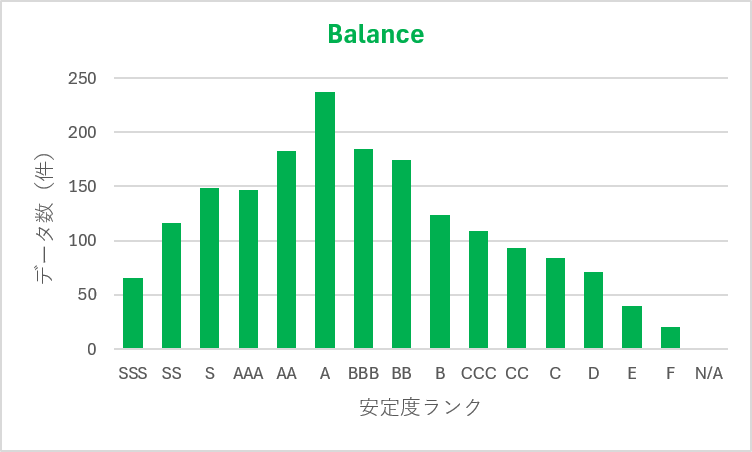
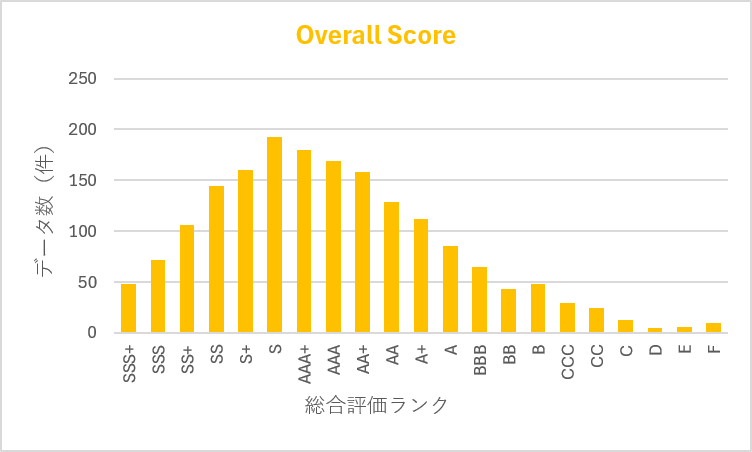
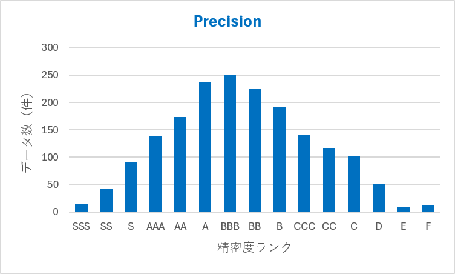
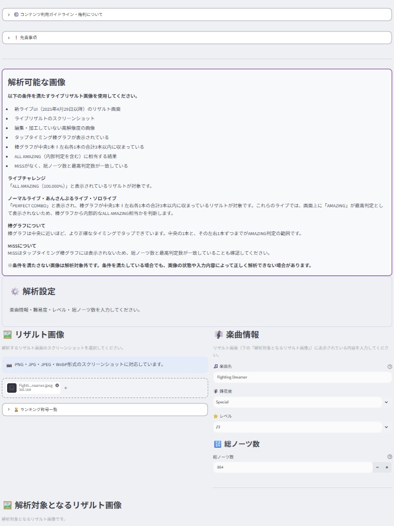
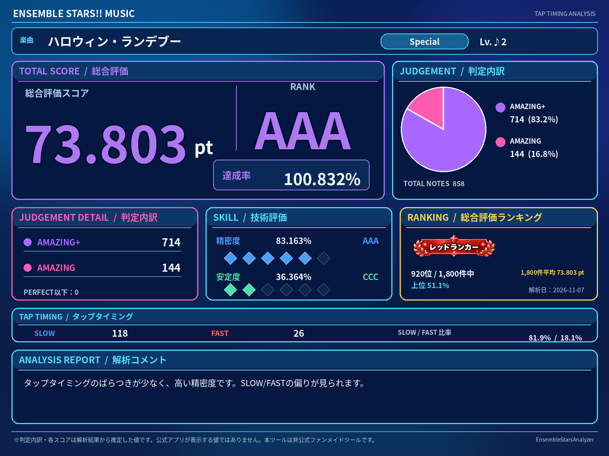
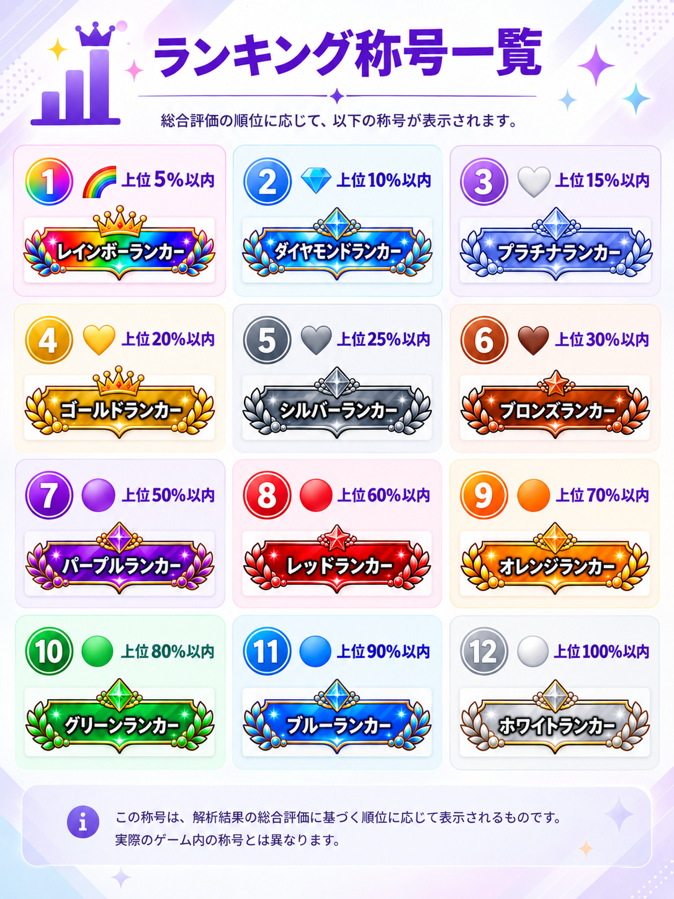

# ensemble-stars-analyzer

**あんさんぶるスターズ！！Music タップタイミング解析Webアプリ**

**Version 3.3.3-dev（2026年11月11日）**

**あんさんぶるスターズ！！Musicのリザルト画像を解析する「タップタイミング解析Webアプリ」です。付属機能として、独立したパチンコ風ミニゲーム「OVERALL PACHINKO」を収録しています。**

リザルト画像をアップロードし、楽曲情報を入力するだけで、判定分布の推定、Precision、Balance、Overall Score、Rank、ランキングなどを確認できます。

> ⚠️ 本ツールは非公式ファンメイドツールです。  
> Happy Elements株式会社とは関係ありません。

---

## 🌟 Webアプリ

**Webアプリ：**

https://ensemble-stars-analyzer.streamlit.app/

現在、無料で利用でき、会員登録は必要ありません。

スマートフォン・タブレット・PCのブラウザから利用できます。

---

## 😴 アプリがスリープしている場合

このWebアプリは、しばらく利用されていないと、一時的にスリープ状態になることがあります。

スリープ画面が表示された場合は、次の手順でアプリを起動してください。

### STEP 1：スリープ解除ボタンを押す

画面に表示される **`Yes, get this app back up!`** ボタンをクリックまたはタップしてください。

### STEP 2：起動するまで待つ

`This will take just a sec! Your app is waking up!` と表示された場合は、アプリが起動するまでそのままお待ちください。

起動には少し時間がかかることがあります。

### STEP 3：通常の画面が表示されたら利用を再開する

アプリの画面が表示されたら、通常どおりリザルト画像をアップロードして解析できます。

### うまく起動しない場合

`Hmm... looks like it's taking longer than normal.` と表示された場合は、少し時間をおいてから再度アクセスしてください。

それでも起動しない場合は、ページを再読み込みして、もう一度お試しください。

---

## 🎰 OVERALL PACHINKO（ミニゲーム）

詳細な操作・ルール・スペック・保留信頼度・RANKボーダーは、OVERALL PACHINKO画面内の「はじめての方へ｜完全ガイド」（全8章）から確認できます。単独のマニュアルは `docs/OVERALL_PACHINKO_BEGINNER_MANUAL.md` にあります。

トップのタブから、リザルト画像を用意しなくても遊べる「OVERALL PACHINKO」を利用できます。

- 通常モード：固定1,799件のOVERALLから重複ありで1件を抽選します。
- 通常時演出：STANDARD／FORESHADOW／QUICKを選択でき、保留入賞・先読み・チャンス・リーチ・最終発展を段階的に表示します。演出段階は演出専用乱数で決まり、抽選結果・確率・出玉には影響しません。
- 小数点以下3桁が同じ数字の場合に初当たりとなり、RUSHへ突入します。
- RUSH：大当たり確率1/73。ST116回転＋残保留最大4個（合計最大120回）。ST本体終了後は新しい保留を追加できず、貯まっている残保留だけを消化します。当たりでST116回転に再セットします。
- RUSH演出モード：STANDARD／SHADOW VISITOR／IMPACT／ONE PUSHを選択でき、RUSH中も変更できます。
- 連チャン数に応じて画面演出が段階的に強化されます。演出は抽選結果確定後の表示であり、抽選確率・出玉には影響しません。
- 結果画面：獲得NOTES・COMBO・払出分布を確認し、結果画像の保存やX共有ができます。

このミニゲームはタップタイミング解析とは独立しています。ゲーム内の公式機能・確率・報酬を再現するものではありません。

## 📌 解析値について

タップタイミング解析は、対象条件を満たすALL AMAZING相当のリザルト画像を対象とします。棒グラフの高さから判定数を推定するため、表示値は実数ではなく参考値です。既存のスコア計算式は維持しています。

---

# 📖 まず最初に

このマニュアルでは、**実際にアプリを使う手順**を中心に説明します。

特に初めて利用する場合は、次の順番で確認してください。

1. 解析できるリザルト画像を用意する
2. リザルト画像をアップロードする
3. 楽曲名・難易度・レベル・総ノーツ数を入力する
4. 「解析開始」を押す
5. 解析結果を確認する
6. リザルトカードを保存する
7. 必要に応じてXで共有する
8. 総合評価ランキングとランキング称号を確認する

---

# 🎮 1．解析できるリザルト画像

解析する前に、使用するスクリーンショットが条件を満たしているか確認してください。

## 対応しているリザルト

現在の対象は、**新ライブUI（2025年4月29日以降）のライブリザルト画面**です。

対応しているライブは以下です。

- ライブチャレンジ
- ノーマルライブ
- あんさんぶるライブ
- ソロライブ

ただし、ライブの種類によって対象となるリザルト表示が異なります。

### ライブチャレンジ

リザルト画面に、

**ALL AMAZING（100.000%）**

と表示されているリザルトが対象です。

### ノーマルライブ・あんさんぶるライブ・ソロライブ

リザルト画面に、

**PERFECT COMBO**

と表示されているリザルトが対象です。

これらのライブでは画面上に「AMAZING」が最高判定として表示されないため、タップタイミング棒グラフから内部的なALL AMAZING相当かを判断します。

---

## 画像の条件

次の条件をすべて満たす画像を使用してください。

- ゲーム内のライブリザルト画面のスクリーンショット
- 新ライブUI（2025年4月29日以降）
- 編集・加工していない画像
- 十分な解像度がある画像
- タップタイミング棒グラフがはっきり表示されている
- 棒グラフが中央1本＋左右各1本の合計3本以内に収まっている
- ALL AMAZING相当の結果
- MISSがない
- 総ノーツ数と最高判定数が一致している

### 棒グラフを見るときのポイント

タップタイミング棒グラフは、**中央に近いほど正確なタイミング**を表します。

対象となるAMAZING判定の棒は、

- 中央
- 中央の左
- 中央の右

の最大3本です。

棒グラフが途中で切れている、ぼやけている、加工されている画像では、正しく解析できない場合があります。

### MISSについて

MISSはタップタイミング棒グラフには表示されません。

そのため、リザルト画面を見て、

**総ノーツ数と最高判定数が一致していること**

も確認してください。

> ⚠️ 条件を満たさない画像は解析対象外です。  
> 条件を満たしていても、画像の状態によって正しく解析できない場合があります。

---

# 📷 2．リザルト画像をアップロードする

Webアプリを開くと、リザルト画像をアップロードする欄があります。

対応している画像形式は、

- PNG
- JPG
- JPEG
- WebP

です。

画像をアップロードすると、入力画面の下に**「解析対象となるリザルト画像」**としてアップロードした画像が表示されます。

アップロードした画像を見て、正しいリザルト画像になっていることを確認してください。

### ファイルサイズ

アップロードできる画像は**最大20MB**です。

20MBを超える画像は解析できません。

---

# 🎼 3．楽曲情報を入力する

画像をアップロードしたら、画像に表示されている楽曲情報を入力します。

## 楽曲名

ゲームのリザルト画面に表示されている曲名を入力してください。

最大**50文字**まで入力できます。

---

## 難易度

以下から選択します。

- Easy
- Normal
- Hard
- Expert
- Special

リザルト画面と同じ難易度を選択してください。

---

## レベル

選択した難易度に応じて、入力できるレベルが変わります。

| 難易度 | 選択できるレベル |
|---|---|
| Easy | 5～10 |
| Normal | 11～17 |
| Hard | 17～26 |
| Expert | 23、24、25、26、26+、27、27+、28、28+、29、29+、30、30+ |
| Special | 26、26+、27、27+、28、28+、29、29+、30、30+、31、31+、♪1～♪6 |

> ※ Expert・Specialでは「+」付きのレベルや「♪」表記のレベルも選択できます。

---

## 🔢 総ノーツ数

**ゲームのリザルト画面に表示されている総ノーツ数を、そのまま入力してください。**

入力範囲は、

**60～1800**

です。

総ノーツ数は非常に重要です。

本ツールでは、棒グラフから判定分布を推定したあと、その割合を入力された総ノーツ数に換算します。

そのため、総ノーツ数を間違えると、推定される判定数やAchievementなどの結果も正しくならない場合があります。

> ⚠️ 総ノーツ数は必ずリザルト画面の表示を確認して入力してください。

---

# ▶️ 4．解析を開始する

入力が終わったら、

**「▶ 解析開始」**

を押してください。

解析では、

1. リザルト画像を読み込む
2. タップタイミング棒グラフを解析する
3. 判定分布を推定する
4. 各種評価を計算する
5. リザルトカードを生成する
6. ランキングを計算する

という処理が行われます。

解析が完了すると、

**「✅ 解析が正常に完了しました。」**

と表示され、結果を確認できます。

---

# 📊 5．解析結果の見方

## 判定分布

リザルト画面のタップタイミング棒グラフから、判定数を推定します。

主に次の項目を確認できます。

- AMAZING+
- AMAZING
- PERFECT
- FAST
- SLOW

ここで表示される判定数は、**ゲーム内部の正式な判定データではなく、画像から推定した値**です。

そのため、ゲーム公式の内部データと完全に一致することを保証するものではありません。

---

## 🏆 Achievement

本ツール独自の達成率です。

表示は小数点以下3桁までです。

理論上の最大値は、

**101.000%**

です。

Achievementはゲーム公式のCHALLENGE RATE値ではありません。

---

## 🎯 Precision（精密度）

タップタイミングの**ばらつきの少なさ**を表す、本ツール独自の指標です。

数値が高いほど、中央付近にタップタイミングが集まっていると評価されます。

表示範囲：

**0～100%**

PrecisionにはS～Fのグレードも表示されます。

### Precisionのグレード

| Precision | グレード |
|---:|:---|
| 88%以上 | SSS |
| 86%以上 | SS |
| 84%以上 | S |
| 82%以上 | AAA |
| 80%以上 | AA |
| 78%以上 | A |
| 76%以上 | BBB |
| 74%以上 | BB |
| 72%以上 | B |
| 70%以上 | CCC |
| 68%以上 | CC |
| 64%以上 | C |
| 60%以上 | D |
| 56%以上 | E |
| 56%未満 | F |

---

## ⚖️ Balance（安定度）

SLOWとFASTの**偏りの少なさ**を表す、本ツール独自の指標です。

SLOWとFASTの割合が近いほど高く評価されます。

表示範囲：

**0～100%**

### Balanceのグレード

| Balance | グレード |
|---:|:---|
| 98%以上 | SSS |
| 94%以上 | SS |
| 88%以上 | S |
| 82%以上 | AAA |
| 74%以上 | AA |
| 64%以上 | A |
| 56%以上 | BBB |
| 48%以上 | BB |
| 42%以上 | B |
| 36%以上 | CCC |
| 30%以上 | CC |
| 24%以上 | C |
| 18%以上 | D |
| 12%以上 | E |
| 12%未満 | F |

---

## ⭐ Overall Score（総合評価）

PrecisionとBalanceをもとに算出する、本ツール独自の総合評価です。

数値が高いほど、総合的に良い結果として評価されます。

現在の評価では、

- Precision：80%
- Balance：20%

の割合でOverall Scoreを算出します。

---

## 🏅 Rank

Overall Scoreに応じて、本ツール独自のRankが決まります。

| Overall Score | Rank |
|---:|:---|
| 86以上 | SSS+ |
| 84～85.999 | SSS |
| 82～83.999 | SS+ |
| 80～81.999 | SS |
| 78～79.999 | S+ |
| 76～77.999 | S |
| 74～75.999 | AAA+ |
| 72～73.999 | AAA |
| 70～71.999 | AA+ |
| 68～69.999 | AA |
| 66～67.999 | A+ |
| 64～65.999 | A |
| 62～63.999 | BBB |
| 60～61.999 | BB |
| 58～59.999 | B |
| 56～57.999 | CCC |
| 54～55.999 | CC |
| 52～53.999 | C |
| 50～51.999 | D |
| 48～49.999 | E |
| 0～47.999 | F |

> ⚠️ Rankは本ツール独自の評価です。ゲーム公式のランクではありません。

---

# 📈 6．1799件の基準データの分布

本ツールのランキングで使用している**1,799件の基準データ**について、Overall Score、Precision、Balanceの分布を参考として掲載しています。

これらのグラフは、基準データの各評価ランクに何件の結果が含まれているかを示したものです。

## ⚖️ Balance（安定度）の分布

1799件の基準データにおけるBalanceランク別の分布です。

<p align="center">
  
</p>

---

## ⭐ Overall Score（総合評価）の分布

1799件の基準データにおけるOverall Scoreランク別の分布です。

<p align="center">
  
</p>

---

## 🎯 Precision（精密度）の分布

1799件の基準データにおけるPrecisionランク別の分布です。

<p align="center">
  
</p>

---

# 🖼️ 7．リザルトカード

解析が完了すると、解析結果をまとめたリザルトカードが表示されます。

リザルトカードには、主に以下の情報がまとめられています。

### 楽曲情報

- 楽曲名
- 難易度
- レベル

### 判定情報

- AMAZING+
- AMAZING
- PERFECT
- GREAT
- GOOD
- BAD
- MISS

### 評価

- Achievement
- Precision
- Precisionグレード
- Balance
- Balanceグレード
- Overall Score
- Rank

### SLOW / FAST

リザルトカード下部には、

**SLOW / FAST**

をまとめて表示します。

それぞれのノーツ数と、全判定数に対する割合を確認できます。

### プレイ傾向

Precision、Balance、SLOW / FASTなどをもとに、現在のプレイ傾向を確認できます。

### 解析コメント

解析結果をもとに、プレイ傾向や評価についてのコメントが表示されます。

### 総合評価ランキング

リザルトカードには、今回の結果について、

- 順位
- 上位何%か
- ランキング称号
- Overall Scoreの分布
- 現在の自分の位置

などを確認できるランキング結果も含まれます。

---

# 💾 8．リザルトカードを保存する

解析結果の下にある、

**「📥 リザルトカードを保存」**

を押すと、リザルトカードをPNG画像として保存できます。

保存されるファイル名は、

`楽曲名_ResultCard.png`

という形式です。

保存した画像は、SNSなどで共有できます。

---

# 𝕏 9．Xで解析結果を共有する

解析結果の下には、

**「𝕏 結果を共有」**

ボタンがあります。

このボタンを押すと、解析結果をもとにしたX投稿画面を開けます。

## 投稿される主な情報

- 楽曲名
- 難易度
- レベル
- AMAZING+
- AMAZING
- FAST
- SLOW
- Achievement
- Precision
- Balance
- Overall Score
- Rank
- ランキング順位
- 上位○%
- WebアプリURL
- ハッシュタグ

### 曲名について

X投稿では曲名を最大20文字まで使用します。

投稿全体が250文字を超える場合は、投稿全体が収まるように曲名がさらに短縮されます。

長い曲名は末尾が「…」になります。

### 画像について

X共有機能は**解析結果をもとにした投稿文とWebアプリURLを作成する機能**です。

アップロードしたリザルト画像そのものをXへ自動投稿する機能はありません。

> ⚠️ Xへ投稿する前に、表示された投稿内容を確認してください。

---

# 🏆 10．総合評価ランキング

解析結果では、Overall Scoreをもとにした本ツール独自のランキングを確認できます。

ランキングは、

**固定された1,799件の基準データ**

と今回の解析結果を比較して計算します。

今回の解析結果を加えると、画面上では、

**1,800件**

として表示されます。

### ランキングの見方

ランキング画面では、

- 順位
- Overall Score
- Rank
- Precision
- Balance
- プレイ傾向

などを確認できます。

現在の解析結果には、

**★あなた**

と表示されます。

### ページ

ランキングは1ページ50件で表示され、

**全36ページ**

あります。

ページ番号を入力して移動したり、「前のページ」「次のページ」で移動したりできます。

### ランキングデータについて

今回の解析結果は、ランキング基準データへ保存・追加されません。

つまり、同じ結果を何度解析しても、それによってランキング基準データ自体が増える仕組みではありません。

ランキングは固定された基準データとの比較結果として表示されます。

### ランキングの基準日

現在のランキング基準データは **2026年8月25日時点** のデータです。

ランキングは今後のデータ追加・更新によって変動する可能性があります。

> ⚠️ このランキングは本ツール独自のランキングです。  
> 『あんさんぶるスターズ！！Music』公式のランキングではありません。

---

# 🏅 11．ランキング称号

ランキング順位の**上位率（%）**に応じて、本ツール独自のランキング称号が決まります。

**上位率は数値が小さいほど上位**です。  
たとえば「上位10%」は、ランキング全体の上位10%以内を意味します。

現在の称号は以下の12種類です。

| 絵文字 | ランキング称号 | ボーダー（上位率） |
|:---:|---|---:|
| 🌈 | レインボーランカー | **上位5%以内** |
| 💎 | ダイヤモンドランカー | **上位10%以内** |
| 🤍 | プラチナランカー | **上位15%以内** |
| 💛 | ゴールドランカー | **上位20%以内** |
| 🩶 | シルバーランカー | **上位25%以内** |
| 🤎 | ブロンズランカー | **上位30%以内** |
| 🟣 | パープルランカー | **上位50%以内** |
| 🔴 | レッドランカー | **上位60%以内** |
| 🟠 | オレンジランカー | **上位70%以内** |
| 🟢 | グリーンランカー | **上位80%以内** |
| 🔵 | ブルーランカー | **上位90%以内** |
| ⚪ | ホワイトランカー | **上位100%以内** |

### 称号の決まり方

上位率を上位から順に判定し、最初に該当するボーダーの称号が表示されます。

たとえば、

- **上位4.0%** → 🌈 レインボーランカー
- **上位7.5%** → 💎 ダイヤモンドランカー
- **上位14.0%** → 🤍 プラチナランカー
- **上位18.0%** → 💛 ゴールドランカー
- **上位24.0%** → 🩶 シルバーランカー
- **上位29.0%** → 🤎 ブロンズランカー
- **上位45.0%** → 🟣 パープルランカー
- **上位55.0%** → 🔴 レッドランカー
- **上位65.0%** → 🟠 オレンジランカー
- **上位75.0%** → 🟢 グリーンランカー
- **上位85.0%** → 🔵 ブルーランカー
- **上位95.0%** → ⚪ ホワイトランカー

という判定になります。

> ⚠️ ランキング称号は本ツール独自のものです。  
> 『あんさんぶるスターズ！！Music』公式の称号・ランキングではありません。

> 📌 ランキングの基準データは固定されています。  
> 現在は1,799件の基準データと今回の解析結果を比較し、画面上では1,800件として表示します。

# 📷 12．実際の画面

実際のWebアプリの画面やリザルトカードを紹介します。

## Webアプリ入力画面

リザルト画像をアップロードし、楽曲名・難易度・レベル・総ノーツ数を入力する画面です。

<p align="center">
  
</p>

---

## 解析結果・リザルトカード

解析完了後に表示されるリザルトカードです。

判定分布、Achievement、Precision、Balance、Overall Score、Rank、SLOW / FAST、ランキングなどをまとめて確認できます。

<p align="center">
  
</p>

---

## ランキング称号一覧

ランキングの上位率に応じて表示される12種類のランキング称号です。

<p align="center">
  
</p>

---

# ✅ 13．利用前に特に確認してほしいこと

初めて利用する場合は、次の4点を確認すると解析に失敗しにくくなります。

1. **新ライブUI（2025年4月29日以降）のリザルト画像を使用する**
2. **タップタイミング棒グラフがはっきり見える画像を使用する**
3. **総ノーツ数をリザルト画面の表示どおりに入力する**
4. **画像を編集・加工せず、そのままアップロードする**

特に、総ノーツ数は推定された判定割合をノーツ数へ換算するために使用されます。入力を間違えると、判定数やAchievementなどの結果に影響します。

---

# ❓ 14．よくある質問

## Q．このツールは無料ですか？

はい。現在、無料で利用できます。

会員登録も必要ありません。

## Q．スマートフォンから利用できますか？

はい。

スマートフォンのブラウザからリザルト画像をアップロードして利用できます。

## Q．どんな画像でも解析できますか？

いいえ。

新ライブUIの対応リザルトで、タップタイミング棒グラフが明確に表示されている画像を使用してください。

特に、編集・加工された画像や解像度の低い画像では正しく解析できない場合があります。

## Q．総ノーツ数はなぜ入力するのですか？

棒グラフから推定した割合を、実際のノーツ数へ換算するためです。

リザルト画面に表示されている総ノーツ数をそのまま入力してください。

## Q．解析結果はゲーム公式の数値ですか？

いいえ。

本ツールがリザルト画像から独自に推定・算出した結果です。

ゲーム内部の正式な判定・評価・計算方法を取得または再現したものではありません。

## Q．ランキングは公式ランキングですか？

いいえ。

本ツール独自の1,799件の基準データを使用したランキングです。

## Q．ランキングに自分の結果は保存されますか？

いいえ。

今回の解析結果はランキング基準データへ保存・追加されません。

画面上で1,800件目として一時的に比較・表示されます。

## Q．X共有すると、リザルト画像も投稿されますか？

いいえ。

X共有では解析結果をもとにした投稿文とWebアプリURLを作成します。

アップロードした画像そのものをXへ自動投稿する機能はありません。

## Q．解析に失敗した場合はどうすればよいですか？

まず、次を確認してください。

1. 対応する新ライブUIのリザルトか
2. 対象となるライブ・リザルト条件を満たしているか
3. 棒グラフがはっきり表示されているか
4. 画像を加工していないか
5. 画像の解像度が十分か
6. 総ノーツ数が正しいか

条件を満たしていても、画像の状態などによって正しく解析できない場合があります。

---

# ⚠️ 15．ご利用上の注意

## 解析結果は推定値です

本ツールは、利用者が用意したリザルト画像を独自の方法で解析して結果を推定します。

ゲーム内部の正式な判定データを取得・改変するものではありません。

そのため、

- 判定分布
- Achievement
- Precision
- Balance
- Overall Score
- Rank
- ランキング

などは、本ツール独自の解析・評価結果です。

ゲーム公式の数値・評価・ランキングではありません。

## 入力内容を確認してください

特に総ノーツ数は解析結果に影響するため、入力間違いがないか確認してください。

## 個人情報に注意してください

アップロードする画像に、個人を特定できる情報などが含まれていないか、アップロード前に確認してください。

第三者が公開した画像を使用する場合は、第三者の権利や利用条件にも配慮してください。

---

# 🔒 16．プライバシーについて

本サービスでは、主に以下の情報を解析のために利用します。

- アップロードされたリザルト画像
- 入力された楽曲名
- 難易度
- レベル
- 総ノーツ数
- 解析によって生成された結果

アップロードされた画像は、解析および解析結果の表示のために一時的に取り扱います。

解析処理のために作成した一時ファイルは、処理後に削除する処理を行います。

本アプリには、アップロード画像や解析結果をユーザー履歴として継続的に保存する機能はありません。

また、解析結果をランキング基準データへ自動的に追加する機能もありません。

ただし、ブラウザやホスティング基盤側で行われるログ・キャッシュその他の取り扱いについては、本アプリの実装だけで保証するものではありません。

---

# 📜 17．利用規約・ガイドライン

本サービスの利用にあたっては、以下の点に注意してください。

- 不正な目的で利用しないでください。
- サービスへ過度な負荷を与える行為を行わないでください。
- 正常な動作を妨害する行為を行わないでください。
- 不正アクセスを試みないでください。
- 第三者の権利を侵害しないでください。
- サービスの運営を妨げる行為を行わないでください。

ゲームおよび関連する名称、画像、ロゴ、キャラクター等の権利は、それぞれの権利者に帰属します。

本ツールはそれらの権利を取得するものではありません。

サービス内容は、メンテナンス、障害、仕様変更その他の事情により変更または停止される場合があります。

---

# 🎮 非公式ファンメイドツールについて

本ツールは、

**『あんさんぶるスターズ！！Music』の非公式ファンメイドツールです。**

Happy Elements株式会社およびその関連会社等とは関係ありません。

『あんさんぶるスターズ！！Music』および関連する名称・コンテンツ等の権利は、それぞれの権利者に帰属します。

本ツールはゲーム公式の機能・サービスではありません。


---

# 2.0 Final — v2〜v7統合版

本リリースでは、v2〜v7で追加・改善したリザルトカードの表示要素を統合し、解析エンジンと学習済みYOLOモデルは今回提供されたプロジェクトを基準に維持しています。

## リザルトカード仕様

- 画像サイズ：**1600 × 1200 px（横：縦＝4：3）**
- DAM「精密採点Ai Heart」の画面構成を参考にした濃紺・シアン基調のデザイン
- 総合評価スコアとランクを大きく表示し、ランクに応じて色を変更（SSS+は虹色）
- 右上に**ドーナツ型ではない通常の円グラフ**を配置
- 円グラフの凡例に判定数と割合を併記
- 判定内訳はAMAZING+・AMAZINGを表示し、PERFECT以下は「PERFECT以下：0」に集約
- 精密度・安定度は6段階のダイヤモンドで表示（チェックマークなし）
- 達成率はAMAZING+ × 1.01、AMAZING × 1.00で計算。カードには「達成率」とだけ表示し、計算式は掲載しない
- ランキング称号は称号画像で表示。順位・上位率は補助情報として控えめに表示
- 1,799件の基準データに今回の結果を加えた1,800件平均と解析日を表示
- SLOW / FASTの件数・比率、解析コメントを維持
- プレイ傾向バッジと1,800件の分布グラフは表示しない
- 免責事項：
  「※判定内訳・各スコアは解析結果から推定した値です。公式アプリが表示する値ではありません。本ツールは非公式ファンメイドツールです。」

## レベル表記

Specialでは31+までの数値レベルに加え、♪1〜♪6を選択できます。カード上では「Lv.♪2」の形式で表示します。

## 主な変更ファイル

- `src/result_card.py`：1600×1200の統合リザルトカード描画
- `src/score.py`：達成率をAMAZING+／AMAZINGの重み付けに統一
- `app.py`：1,800件平均の算出とカードへの解析日・ランキング情報の受け渡し
- `src/config.py`：アプリバージョンを2.0 Finalへ更新
- `assets/result_card.png`：統合版リザルトカードのプレビュー

## 解析上の注意

判定内訳・各スコア・ランキングは画像解析および本ツールの基準データから推定・算出した値です。ゲーム公式アプリの内部値や公式ランキングではありません。

---

## 3.0.0-dev 開発状況（2026年11月7日）

本リポジトリは2.0 Finalを基準に、3.0への安全な移行を開始しています。現段階では解析モデル、評価計算、ランク境界、ランキング基準データ、リザルトカードのデザインは維持し、同時利用時の一時ファイル競合、日時のタイムゾーン、判定バリデーション、回帰テストを先に整備しています。

**画面デザインの全面刷新はまだ完了していません。** README内の画面画像・操作説明は、3.0の画面が確定した後に実際のWebアプリのスクリーンショットへ差し替えてください。

開発方針と変更範囲は [`DEVELOPMENT_PLAN_v3.md`](DEVELOPMENT_PLAN_v3.md)、変更履歴は [`CHANGELOG_v3.0.0-dev.md`](CHANGELOG_v3.0.0-dev.md) を参照してください。

---

# 🎰 OVERALL PACHINKO 詳細マニュアル（3.3.0-dev）

OVERALL PACHINKOは、タップタイミング解析とは独立したミニゲームです。解析用スコア計算式・固定ランキング基準データは変更しません。

## 1. 通常時・初当たり

- 固定1,799件のOVERALLデータから、重複ありで1件ずつ抽選します。
- 小数点以下3桁が同じ数字なら通常初当たりです。
- 通常初当たり確率は約1/34.6です。
- 通常初当たり後は必ずRUSHへ突入します。
- 150回転連続で初当たりがない場合、150回転目に遊タイムが発動します。

| 通常初当たり図柄 | 出玉 | 件数 | 振り分け |
|---|---:|---:|---:|
| `000` | 1,500 NOTES | 29 | 29/52 |
| `222 / 444 / 666 / 888` | 300 NOTES | 14 | 14/52 |
| `111 / 333 / 555 / 999` | 3,000 NOTES | 8 | 8/52 |
| `777` | 4,500 NOTES | 1 | 1/52 |

## 2. 遊タイム

- 発動条件：通常時に150回転連続で初当たりがないこと。
- 150回転目の抽選がハズレの場合に発動します。
- 発動時は6,000 NOTESを獲得し、RUSHへ突入します。
- 表示区分は `PITY TIME`、初当たりOVERALLは `--.---` です。
- 理論発動確率は `(1 - 1/34.6)^150` = 約1.2288%です。
- 通常時の大当たり確率約1/34.6と遊タイム発動確率は合算しません。

## 3. RUSH

- 大当たり確率：1/73
- ST本体：116回転
- ST終了時の残保留：最大4個（最大合計120回）
- ST本体終了後は保留追加不可。すでに貯まっている残保留だけを消化
- 残保留を消化し終えると終了
- ST本体のみの継続期待度：約79.81%
- 残保留4個を含む最大120回の継続期待度：約80.89%

| RUSH大当たり出玉 | 振り分け |
|---:|---:|
| 300 NOTES | 20% |
| 1,500 NOTES | 50% |
| 3,000 NOTES | 15% |
| 4,500 NOTES | 10% |
| 6,000 NOTES | 5% |
| **合計** | **100%** |

RUSH大当たり1回あたりの平均出玉は2,010 NOTESです。ルーレットは演出であり、出玉は演出開始前に決定されます。

保留は最大5個、HOLD長押し中は0.5秒ごとに追加します。STは保留追加時ではなく消費時に減少します。大当たり中は保留処理を停止し、当たり時に未消費の保留4個は当否・色を保持して次のRUSHへ持ち越します。

## 4. 理論期待出玉

| 指標 | 理論値 |
|---|---:|
| 通常初当たり平均出玉 | 約1,465.38 NOTES |
| 遊タイム込み通常時出玉期待値 | 約1,521.11 NOTES |
| RUSH大当たり回数期待値 | 約4.23412回 |
| RUSH獲得期待出玉 | 約8,510.58 NOTES |
| 通常時開始からの総獲得期待出玉 | 約10,031.69 NOTES |

「RUSH獲得期待出玉」と「通常時開始からの総獲得期待出玉」は異なる指標です。

## 5. 100万件シミュレーション

アプリ内に、1,000,000件の試行件数、遊タイム発動件数・割合、通常初当たり件数、RANK別件数・割合、ヒストグラムを表示します。理論値とシミュレーション実測値は別々に表示します。試行単位は「件」です。

再現条件・個別試行CSV.gz・集計JSON・RANKヒストグラムCSVは `output/simulation/` に保存します。標準乱数シードは20261111です。

## 6. RANKボーダー・カラー

| RANK | 最低獲得NOTES | RANK | 最低獲得NOTES |
|---|---:|---|---:|
| SSS+ | 60,000 | SSS | 50,400 |
| SS+ | 44,700 | SS | 40,500 |
| S+ | 36,900 | S | 33,300 |
| AAA+ | 29,700 | AAA | 26,400 |
| AA+ | 23,400 | AA | 20,700 |
| A+ | 18,300 | A | 15,900 |
| BBB | 14,100 | BB | 12,300 |
| B | 9,900 | CCC | 7,800 |
| CC | 5,400 | C | 3,300 |
| D | 1,800 | E | 1,500 |
| F | 300 | | |

カラー：SSS+/SSS＝虹、S系＝金、A系＝赤、B系＝青、C系＝緑、D＝ピンク、E＝紫、F＝灰色。RANKカラーはNOTES数値の色とは独立しています。

## 7. リザルト・共有

リザルトには初当たり区分・初当たりOVERALL・初当たり回転数・初当たり出玉・RUSH大当たり回数・RUSH獲得NOTES・RUSH消化回転数・総獲得NOTES・RANK・出玉振り分け・日時を表示します。

- `最高COMBO` と総回転数は表示しません。
- 遊タイム時の初当たりOVERALLは `--.---` と表示し、データベースにはNULLで保存します。
- QRコードはリザルトカード内だけに表示します。
- 出玉円グラフは当選回数の内訳で、割合は円グラフ内に表示します。
- X共有文は実際の改行で生成します。
- スマートフォンの画像保存・音声はOS・ブラウザに依存するため実機確認が必要です。

## 8. Supabaseランキング設定

詳しい画面操作は `SUPABASE_SETUP_3.3.0-dev.md` を参照してください。

新規Supabaseプロジェクトでは、SQL Editorで `supabase/pachinko_schema.sql` の内容を実行します。テーブル、RLSポリシー、ランキング順位を返すRPC関数を作成します。

Streamlit Secretsには次の値を登録します。

```toml
SUPABASE_URL = "https://YOUR_PROJECT.supabase.co"
SUPABASE_PUBLISHABLE_KEY = "sb_publishable_..."
```

旧形式の `SUPABASE_ANON_KEY` も互換のため読み込みます。新しい `sb_publishable_...` キーは `apikey` ヘッダーだけに設定し、Bearer JWTとしては送信しません。旧形式のanon JWTではBearerヘッダーも使用します。`service_role` / `sb_secret` キーは絶対にブラウザへ公開しないでください。アプリ側でも新形式の `sb_secret_` と旧形式JWTの `service_role` を検出してランキング接続を停止します。

現在の公開ランキング方式は、匿名ユーザーに結果のINSERTとSELECTを許可します。これは共有ランキングを簡単に有効化するための方式であり、投稿者本人の正当性やスコアの正しさをサーバーで証明するものではありません。不正投稿防止を強化する場合は、Supabase Edge Function等でサーバー側検証を行う設計へ移行してください。

## 9. 参考にしたパチンコ機種情報

- [e女神のカフェテラスJLZ（DMMぱちタウン）](https://p-town.dmm.com/machines/4848)
- [e/Re:ゼロから始める異世界生活 鬼がかり2/M24（DMMぱちタウン）](https://p-town.dmm.com/machines/5094)

機種ごとの演出・スペックをそのまま再現するのではなく、保留色・信頼度・特図など、初めて遊ぶ人にも仕組みが伝わる構成を参考にしています。

---


## 旧版変更履歴：OVERALL PACHINKO（3.2.5-dev）

- 通常時の初当たり確率：約1/35（固定1,799件中52件）
- RUSH突入率：100%／RUSH大当たり確率：1/73／ST：120回転／継続率：約81%
- RUSH出玉：300 NOTES 20%、1,500 NOTES 55%、3,000 NOTES 12.5%、6,000 NOTES 12.5%
- 初当たり後・RUSH大当たり後はレインボー演出を表示。RUSH出玉決定は確率抽選で、ルーレット停止操作では抽選結果は変わりません。
- スマートフォンでは抽選図柄の直下に操作ボタンを配置し、スペック・遊び方・RANK表はページ内の折りたたみ表示です。
- 音声は最初のユーザー操作後に有効化します。端末・ブラウザ側の音量や消音設定も確認してください。
- 総獲得NOTES／RUSH獲得NOTES：4,999以下は銀、5,000～9,999は金、10,000以上は虹。
- RANKボーダー：SSS+ 55,200、SSS 46,500、SS+ 41,100、SS 36,900、S+ 33,300、S 30,300、AAA+ 27,600、AAA 24,900、AA+ 22,500、AA 20,100、A+ 18,000、A 15,600、BBB 13,800、BB 11,700、B 9,600、CCC 7,800、CC 5,100、C 3,300、D 1,800、E 1,500、F 300以上。
- マニュアル・特図・保留信頼度・ランク表はゲーム画面内の折りたたみ説明に掲載しています。


---

## 3.2.8-dev（2026年11月10日）変更点

- OVERALL PACHINKOの初当たり回転数表示、RANK分布表示、獲得期待出玉表示を更新。
- RUSH大当たり時に未消化保留を次のSTへ引き継ぐ仕様に変更。
- 初当たり出玉の色分けとリザルトカードの円グラフ割合表示を更新。
- スマートフォンではリザルト画像を画面内に表示し、画像を長押しして写真へ保存できる操作を追加（iOS Safariでの実機確認は必要）。


## OVERALL PACHINKO 演出マニュアル

演出モード、RUSH専用告知の信頼度・出現率、遊タイムカウントダウン、結果カード仕様は `docs/OVERALL_PACHINKO_PRESENTATION_MANUAL.md` を参照してください。
